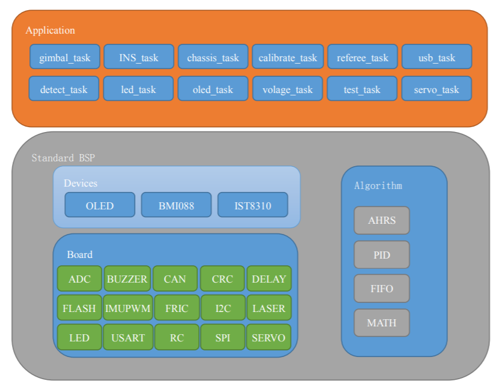

# 2026 哨兵机器人固件

本项目基于 STM32F407IGHx、FreeRTOS 和 RM 开发板 C 型，包含麦轮底盘、Yaw/Pitch 云台、BMI088 惯导、PWM 摩擦轮、CAN 拨弹轮、裁判系统、OLED、Jetson USB 双向通信和舵机调试功能。

**第一次连接 Jetson，请直接看 [README_USB.md](README_USB.md)。**

英文说明见 [doc/en/readme.md](doc/en/readme.md)。

## 开发环境

- Toolchain/IDE：MDK-ARM V5
- STM32F4xx_DFP：2.13.0
- STM32CubeMX：5.2.1
- STM32Cube FW_F4：V1.21.1
- FreeRTOS：10.0.1
- CMSIS-RTOS：1.02

## 上电安全检查

1. 架空底盘并清空车轮、云台、拨弹轮的运动范围。
2. 取出弹丸。发射机构触动开关阻力很小，弹丸越过触动开关后可能挤住摩擦轮，导致摩擦轮磨损或启动失败。
3. 检查云台线束不会在 Yaw 转动时缠绕。
4. 首次测试先将两个拨杆置于下方，确认设备无异常动作后再使能。

## 遥控器操作

### 摇杆

| 控件 | 功能 |
|---|---|
| 右摇杆上下 | 底盘前进、后退 |
| 右摇杆左右 | 底盘左右平移 |
| 左摇杆上下 | 云台 Pitch 抬头、低头 |
| 左摇杆左右 | 云台 Yaw 左右旋转 |

### 三档拨杆

当前代码中 `s[0]` 是左拨杆、`s[1]` 是右拨杆。

| 控件 | 下 | 中 | 上 |
|---|---|---|---|
| 左拨杆 | 通常为云台/底盘无力；两个拨杆同时向下时进入键鼠模式 | 云台使能，底盘小陀螺自转 | 云台使能，底盘跟随云台 |
| 右拨杆 | 关闭摩擦轮并停止发射 | 开启摩擦轮，不拨弹 | 开启摩擦轮并连续拨弹 |

遥控器侧面拨轮（通道 4）目前只解析、不参与控制。当前主动输入逻辑没有启用单发状态；右拨杆上为连续拨弹。

## 键鼠操作

从小陀螺切到跟随云台时，底盘会沿退出前自转指令的方向继续回正，并限制 yaw 指令变化率。若最近对齐点不足以平滑刹停，会跳过该点选择后续同向目标；普通跟随接管后仍保留限速。无力模式立即取消过渡。参数、时间代价和实机待测项见 [底盘同向回正修改说明](doc/底盘同向回正修改说明.md)。

将左右拨杆都置于下方，再使用以下按键：

| 输入 | 功能 |
|---|---|
| `Ctrl+X` | 云台使能，底盘跟随云台 |
| `Ctrl+Z` | 云台使能，底盘进入小陀螺 |
| `Ctrl+C` | 云台、底盘无力 |
| `W/S` | 前进、后退 |
| `A/D` | 左移、右移 |
| 鼠标移动 | 控制云台 Yaw/Pitch |
| `F` | 云台转向约 180° |
| `Q` / `E` | 开启 / 关闭摩擦轮 |
| 鼠标左键 | 拨弹轮正转，连续拨弹 |
| 鼠标右键 | 拨弹轮反转，用于退弹或清卡 |
| `Ctrl` | 跟随模式下使底盘左右摆动 |

`R`、`G`、`B` 和鼠标滚轮目前未参与控制。

### 舵机调试键与已知冲突

舵机任务已创建并持续运行：

- `Z/X/C/V`：分别增加舵机 1/2/3/4 的 PWM。
- `Shift+Z/X/C/V`：分别减小对应舵机 PWM。

因此 `Ctrl+Z`、`Ctrl+X`、`Ctrl+C` 在切换整车模式时，也会分别增加舵机 1、2、3 的 PWM。连接舵机时应特别注意，这是当前代码中的已知按键冲突。

## 校准

校准入口要求左右拨杆都处于下方。第一步统一为“双摇杆下内八”保持 2 秒；第一步完成后须在 20 秒内完成第二步。

| 项目 | 第二步（保持 2 秒） | 校准行为 |
|---|---|---|
| 陀螺仪 | 双摇杆下外八 | 禁用遥控输入并采集约 20 秒静止数据，计算零漂 |
| 云台 | 双摇杆上外八 | 自动执行 Pitch 上限、Pitch 下限、Yaw 正向限位、Yaw 反向限位 |
| 底盘电机 ID | 双摇杆上内八 | 发送 `0x700` 快速设置 ID 命令 |

### 陀螺仪校准注意事项

- 开发板首次烧录或参数区被清空时会自动请求校准。
- 将机器人水平、完全静止，远离振动源。
- 固件把 IMU 控温目标更新为触发时 MCU 温度加 10 ℃，并限制在允许的最高温度内。
- 校准期间 DBUS 接收被暂时关闭；蜂鸣器停止后恢复。

### 云台校准注意事项

- 底盘必须水平，云台四周不能有障碍物，线束不能缠绕。
- 云台由电机自动转动，不要手动拖动 Yaw。
- 运动顺序为 Pitch 抬头、Pitch 低头、Yaw 一个方向到限位、Yaw 反方向到限位。
- 如果 Pitch 因配重问题迟迟不能稳定在限位，可避开夹手位置轻托后立即松开；若持续顶死、剧烈抖动或方向异常，应立即断电检查电机方向、编码器和 IMU 安装。

### 底盘电机 ID 校准

触发后 C620 电调显示黄灯。架空底盘并按以下顺序手动转动车轮：右前、左前、左后、右后。

校准完成的数据写入 Flash 用户参数区。

## 主要通信与执行器

| 模块 | 当前实现 |
|---|---|
| 底盘 M1–M4 | CAN1，组控制 ID `0x200` |
| Yaw、Pitch、拨弹轮 | CAN1；反馈 ID `0x205/0x206/0x207`，组控制 ID `0x1FF` |
| 摩擦轮 | TIM1 CH1/CH2 PWM，开环控制 |
| BMI088 | SPI + 数据就绪中断 + DMA |
| 遥控器 | DBUS/SBUS，18 字节帧 |

虽然工程初始化了 CAN2，但 `CAN_receive.h` 中底盘和云台总线宏当前都指向 `hcan1`。

## 离线状态

OLED 可显示模块状态：M1–M4 为底盘电机，M5 为 Yaw，M6 为 Pitch，M7 为拨弹轮，DBUS 为遥控器，GYR/ACC/MAG 为板载传感器，REF 为裁判系统。

蜂鸣器按照错误列表顺序提示首个离线模块，但当前循环只检查到 `REFEREE_TOE` 之前，因此不会用声音提示裁判系统、RM IMU 和 OLED。摩擦轮是无反馈 PWM 开环设备，不在离线检测列表中；未连接或故障时不会自动报警。

开发板 USB 虚拟串口使用 StandardRobot++ 二进制协议与 Jetson 通信，接收底盘速度指令，并向 ROS 2 上报 IMU、关节状态、实测速度和机构在线状态。协议、权限配置和视觉调试命令见 [哨兵USB通信与ROS调试.md](哨兵USB通信与ROS调试.md)。

## 文档索引

- [代码分析文档](代码分析文档.md)
- [快速参考指南](快速参考指南.md)
- [摩擦轮通讯方式分析](摩擦轮通讯方式分析.md)
- [陀螺仪使用分析报告](陀螺仪使用分析报告.md)
- [陀螺仪安装方向影响分析](陀螺仪安装方向影响分析.md)
- 原上游文档曾引用 `doc/cn/2020年外赠步兵机器人使用手册.pdf` 和 `doc/cn/2020年外赠步兵机器人开发手册.pdf`，但当前工作区未包含这两个 PDF。

## 软件结构

主要任务在 `Src/freertos.c` 中创建，包括校准、底盘、检测、云台、INS、LED、OLED、裁判系统、USB、电压检测和舵机任务。云台任务同时调用射击控制，并通过 CAN 发送 Yaw、Pitch 和拨弹轮电流。

主控 MCU 为 STM32F407IGHx，主频 168 MHz；底盘采用 X 型麦轮布局。
